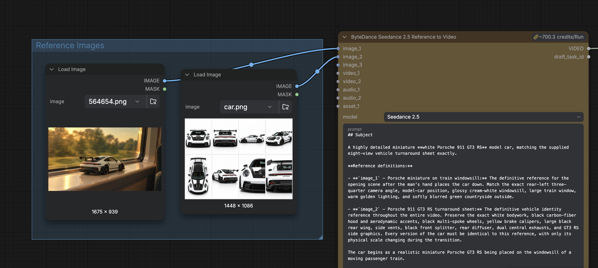

# Car Transition

A 10-second shot in which a miniature Porsche on a train windowsill becomes a full-sized car driving out of a tunnel into a city at night. Seedance 2.5 renders it from two reference images and a timed prompt.

| | |
| --- | --- |
| **What it makes** | A 10-second, 720p, 16:9 video with sound. A hand sets a model Porsche 911 GT3 RS on the windowsill of a moving train. The train enters a tunnel, and in the dark the model becomes a real car on a road. The car drives out of the tunnel into city lights at night. |
| **How it works** | One Seedance 2.5 reference Node takes two images. One sets the opening shot on the windowsill. The other, a turnaround sheet, keeps the car the same in every frame. There is no blockout video: the prompt sets the timing with five timestamped beats. |
| **Why it's worth a look** | It hides a change of scale inside a moment of darkness, so the car never visibly grows. The same idea works for any miniature-to-real or real-to-miniature transition. |

## Contents

- [01 · Shared on](#01--shared-on)
- [02 · Files](#02--files)
- [03 · Run on Comfy Cloud](#03--run-on-comfy-cloud)
- [04 · Run on Comfy Desktop or a local ComfyUI](#04--run-on-comfy-desktop-or-a-local-comfyui)
- [05 · Inputs](#05--inputs)
- [06 · The prompt](#06--the-prompt)
- [07 · Make it your own](#07--make-it-your-own)
- [08 · Troubleshooting](#08--troubleshooting)

## 01 · Shared on

| Channel | Link |
| --- | --- |
| X | [@ComfyUI, post 2115451076799606868](https://x.com/ComfyUI/status/2115451076799606868) |
| Discord | _Not yet shared._ |
| LinkedIn | _Not yet shared._ |
| Reddit | _Not yet shared._ |

## 02 · Files

| File | What it is |
| --- | --- |
| [car-transition_local.json](car-transition_local.json) | The Workflow for Comfy Desktop or a local ComfyUI. Its `Load Image` Nodes point at the files in `media/`. |
| [Open in Comfy Cloud](https://t.co/jAxGir8qij) | The Workflow on Comfy Cloud. Requires a Comfy account. |
| [media/train-windowsill.png](media/train-windowsill.png) | `image_1`. The miniature Porsche on the train windowsill. |
| [media/porsche-turnaround.png](media/porsche-turnaround.png) | `image_2`. The eight-view Porsche 911 GT3 RS turnaround sheet. |

## 03 · Run on Comfy Cloud

| Step | What to do |
| --- | --- |
| Open | Open the [Car Transition Workflow on Comfy Cloud](https://t.co/jAxGir8qij). If the canvas opens empty, sign in first. |
| Run | Click **Run**. The inputs are already loaded. |
| Cost | Seedance 2.5 is a Partner Node, so each run spends Comfy Credits. At these settings, the Node estimates about 700 credits per run. |

> [!CAUTION]
> Before you run, check the credit estimate above the Partner Node. It changes with duration and resolution.

## 04 · Run on Comfy Desktop or a local ComfyUI

This is the same Workflow as the Cloud version, but you supply the input files.

> [!NOTE]
> Seedance 2.5 is a Partner Node. It runs on ByteDance's servers, so you don't need a GPU. When ComfyUI runs on your machine, the Node still sends the job to ByteDance through Comfy and spends Comfy Credits.

| Step | What to do |
| --- | --- |
| Requirements | Comfy Desktop, or ComfyUI with frontend 1.60.0, the version this Workflow was saved with. A Comfy account with Comfy Credits. |
| Custom Nodes | None. |
| Models | None. |
| Copy the inputs | Copy `train-windowsill.png` and `porsche-turnaround.png` from `media/` into `ComfyUI/input`. You don't need the screenshot. |
| Load | Drag `car-transition_local.json` onto the canvas. |
| Sign in | Sign in to your Comfy account in Comfy Desktop. Partner Nodes require it. |
| Run | Click **Run**. The video saves to `ComfyUI/output/video/` with the prefix `Seedance2.5_r2v`. |

## 05 · Inputs

Both images connect to one `ByteDance2ReferenceNodeV2` Node.

| Input | File | What it controls |
| --- | --- | --- |
| `image_1` | `train-windowsill.png` | The opening shot: camera angle, the car's position on the windowsill, the train window, and the golden-hour light |
| `image_2` | `porsche-turnaround.png` | The car itself: white body, carbon-fiber hood, black wheels, yellow brake calipers, rear wing, and side graphics |

*The two Load Image Nodes and the Seedance 2.5 Node. The Nodes in this screenshot show the original file names, `564654.png` and `car.png`.*

| Setting | Value |
| --- | --- |
| `model` | Seedance 2.5 |
| `resolution` | 720p |
| `ratio` | 16:9 |
| `duration` | 10 |
| `generate_audio` | On |
| `task_type` | reference |
| `output_format` | mp4 |
| `auto_downscale` | On |
| `seed` | Randomized each run |

## 06 · The prompt

The prompt is in the Node's text box. Without a blockout, the prompt carries the timing:

| Section | What it does |
| --- | --- |
| Subject | Defines each image by its slot, and describes the car and both settings: the train and the city at night. |
| Action | Lists five beats with timestamps: the hand places the car (0.0 to 2.0 s), the train enters a tunnel (2.0 to 4.0 s), the car becomes full-sized in the dark (4.0 to 6.5 s), it drives through a road tunnel (6.5 to 8.5 s), and it exits into the city (8.5 to 10.0 s). |
| Camera | Locks the camera during the train scene, then switches to a tracking shot from the same rear-left three-quarter angle. |
| Style | Photorealistic car footage that moves from golden hour to night, with no visible transformation effects. |
| Constraints | Repeats the timeline, then sets rules for the car's identity, the opening shot, the tunnel transition, and the ending, followed by a list of negatives. |

## 07 · Make it your own

| Change | How |
| --- | --- |
| Use your own car or object | Swap `image_2` for a turnaround sheet of your object, and make a matching opening shot for `image_1`. Update the descriptions in the Subject section. |
| Change the destination | Edit the 8.5 to 10.0 s beat and the Ending change rule in Constraints. |
| Change the timing | Edit the timestamps in Action and Constraints, and set `duration` to the new length. |
| Run a cheaper test | Try a different open-weight model or Partner Node. |

## 08 · Troubleshooting

| Problem | Try this |
| --- | --- |
| A `Load Image` Node shows a missing file | The file isn't in `ComfyUI/input`, or its name changed. The names must match exactly: `train-windowsill.png`, `porsche-turnaround.png`. |
| The Node asks you to sign in | Sign in to your Comfy account in Comfy Desktop, then run the Workflow again. |
| The run fails with a credits error | Add Comfy Credits to your Comfy account. |
| The car grows or stretches on screen | Run it again with a new seed. The prompt hides the change of scale in the tunnel's darkness, and some seeds show it anyway. |
