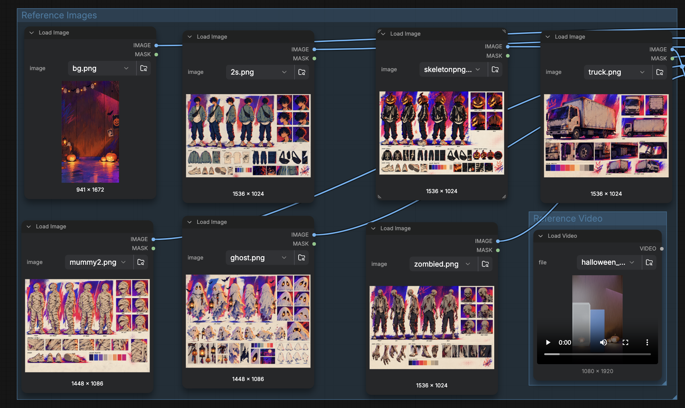
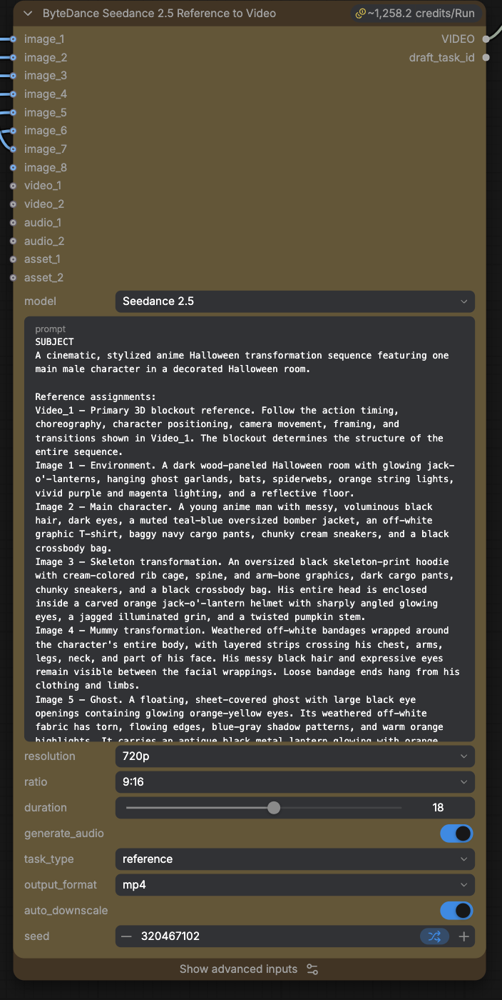

# Halloween SD

An 18-second vertical anime Halloween short in which one character changes costume on every beat. Seedance 2.5 renders it from a 3D blockout and seven reference images.

| | |
| --- | --- |
| **What it makes** | An 18-second, 720p, 9:16 video with sound. A young man stands in a decorated Halloween room. A ghost possesses him, a jack-o'-lantern lands on his head, and he becomes a skeleton, a giant pumpkin, a tiny version of himself, and a mummy. Zombies, a box truck, and a shower-curtain scene follow, and the last frame matches the first so the video loops. |
| **How it works** | One Seedance 2.5 reference Node takes a blockout video and seven images. The blockout controls the camera, the action order, and the timing. Each image defines one character, costume, prop, or the room. A long, structured prompt assigns each reference one job and lists the beats with timestamps. |
| **Why it's worth a look** | It shows how far one blockout can stretch: 14 timed beats and six looks for one character, in one Node. The prompt is a template for scripting many beats against a blockout without the model adding or reordering events. |

## Contents

- [01 · Shared on](#01--shared-on)
- [02 · Files](#02--files)
- [03 · Run on Comfy Cloud](#03--run-on-comfy-cloud)
- [04 · Run on Comfy Desktop or a local ComfyUI](#04--run-on-comfy-desktop-or-a-local-comfyui)
- [05 · Inputs](#05--inputs)
- [06 · The prompt](#06--the-prompt)
- [07 · Make it your own](#07--make-it-your-own)
- [08 · Troubleshooting](#08--troubleshooting)

## 01 · Shared on

| Channel | Link |
| --- | --- |
| X | [@ComfyUI, post 2113682376815779899](https://x.com/ComfyUI/status/2113682376815779899) |
| Discord | _Not yet shared._ |
| LinkedIn | _Not yet shared._ |
| Reddit | _Not yet shared._ |

## 02 · Files

| File | What it is |
| --- | --- |
| [halloween-sd_local.json](halloween-sd_local.json) | The Workflow for Comfy Desktop or a local ComfyUI. Its `Load Image` and `Load Video` Nodes point at the files in `media/`. |
| [Open in Comfy Cloud](https://t.co/2pO0ixzDbu) | The Workflow on Comfy Cloud. Requires a Comfy account. |
| [media/room.png](media/room.png) | `image_1`. The Halloween room. |
| [media/main-character.png](media/main-character.png) | `image_2`. The main character's turnaround sheet. |
| [media/skeleton.png](media/skeleton.png) | `image_3`. The skeleton hoodie and jack-o'-lantern head. |
| [media/mummy.png](media/mummy.png) | `image_4`. The mummy costume. |
| [media/ghost.png](media/ghost.png) | `image_5`. The ghost and its lantern. |
| [media/zombies.png](media/zombies.png) | `image_6`. The zombies. |
| [media/truck.png](media/truck.png) | `image_7`. The white box truck. |
| [media/halloween-blockout-18s.mp4](media/halloween-blockout-18s.mp4) | `video_1`. The 18-second 3D blockout. |

## 03 · Run on Comfy Cloud

| Step | What to do |
| --- | --- |
| Open | Open the [Halloween SD Workflow on Comfy Cloud](https://t.co/2pO0ixzDbu). If the canvas opens empty, sign in first. |
| Run | Click **Run**. The inputs are already loaded. |
| Cost | Seedance 2.5 is a Partner Node, so each run spends Comfy Credits. At these settings, the Node estimates about 1,258 credits per run. |

> [!CAUTION]
> Before you run, check the credit estimate above the Partner Node. It changes with duration and resolution.

## 04 · Run on Comfy Desktop or a local ComfyUI

This is the same Workflow as the Cloud version, but you supply the input files.

> [!NOTE]
> Seedance 2.5 is a Partner Node. It runs on ByteDance's servers, so you don't need a GPU. When ComfyUI runs on your machine, the Node still sends the job to ByteDance through Comfy and spends Comfy Credits. To run on your own GPU, replace the Node with an open video model that supports reference inputs and fits in your VRAM.

| Step | What to do |
| --- | --- |
| Requirements | Comfy Desktop, or ComfyUI with frontend 1.60.0, the version this Workflow was saved with. No GPU. A Comfy account with Comfy Credits. |
| Custom Nodes | None. |
| Models | None. |
| Get the files | Download this folder. On GitHub, select **Code > Download ZIP** to get the whole repo, or download each file in `media/`. |
| Copy the inputs | Copy the seven images and the blockout video from `media/` into `ComfyUI/input`. You don't need the screenshots. In Comfy Desktop, open the input folder from the app menu. |
| Load | Drag `halloween-sd_local.json` onto the canvas. |
| Sign in | Sign in to your Comfy account in Comfy Desktop. Partner Nodes require it. |
| Run | Click **Run**. The video saves to `ComfyUI/output/video/` with the prefix `Seedance2.5_r2v`. |

## 05 · Inputs

All eight inputs connect to one `ByteDance2ReferenceNodeV2` Node. The prompt calls the images "Image 1" to "Image 7" and the video "Video_1", in the same order as the Node's input slots.

| Slot | File | What the model takes from it |
| --- | --- | --- |
| `image_1` | `room.png` | The wood-paneled room, jack-o'-lanterns, ghost garlands, bats, string lights, and purple and magenta lighting |
| `image_2` | `main-character.png` | The main character's face, hair, teal bomber jacket, graphic T-shirt, cargo pants, sneakers, and crossbody bag |
| `image_3` | `skeleton.png` | The skeleton-print hoodie and the jack-o'-lantern helmet |
| `image_4` | `mummy.png` | The bandage wrapping, with his eyes and some hair still visible |
| `image_5` | `ghost.png` | The sheet ghost, its glowing eyes, and its lantern |
| `image_6` | `zombies.png` | The zombies' faces, clothes, and hands |
| `image_7` | `truck.png` | The white box truck's shape and wear |
| `video_1` | `halloween-blockout-18s.mp4` | Camera, framing, action order, character positions, transitions, timing, and length |

*The Reference Images and Reference Video groups. The Nodes in this screenshot show the original file names, such as `bg.png` and `2s.png`.*

| Setting | Value |
| --- | --- |
| `model` | Seedance 2.5 |
| `resolution` | 720p |
| `ratio` | 9:16 |
| `duration` | 18, to match the blockout |
| `generate_audio` | On |
| `task_type` | reference |
| `output_format` | mp4 |
| `auto_downscale` | On |
| `seed` | Randomized each run |

*The Seedance 2.5 Node with its inputs, the start of the prompt, and its settings.*

## 06 · The prompt

The prompt is in the Node's text box. It is long on purpose. Its structure is the part you can reuse:

| Section | What it does |
| --- | --- |
| Subject | Defines each reference by label and says what it controls. `Video_1` sets the structure of the whole sequence. |
| Action | Lists 14 numbered beats, each with a timestamp from the blockout, from the ghost's approach at 0.0 s to the final reveal at 16.9 s. Each beat says what changes and what stays the same. |
| Camera | Makes the blockout the only camera source and says which side of the frame each element enters from. |
| Style | Bold 2D anime with ink outlines, cel shading, halftone textures, and a purple, magenta, blue, and orange palette. Repeats which image defines each element. |
| Constraints | Fixes the length at 18 s and the action order, then lists what must not appear: extra characters, camera cuts, photorealism, text, or graphic violence. |
| Final priority | Restates the rule in two sentences: the blockout decides what happens and when, and the images decide how it looks. |

## 07 · Make it your own

| Change | How |
| --- | --- |
| Use your own scene | Block the scene in Blender, Unreal, or any 3D tool. Render a gray pass at the length you want, and swap it into `video_1`. Set `duration` to match, and update the timestamps in the Action section. |
| Use your own characters or costumes | Swap the image in that slot, and update its description in the Subject section and its line in Style and Constraints. |
| Add or remove a beat | Edit the numbered beat in the Action section and the matching rule in Constraints. Keep the beats in the same order as the blockout. |
| Run a cheaper test | Try a different open-weight model or Partner Node. |

## 08 · Troubleshooting

| Problem | Try this |
| --- | --- |
| A Load Node shows a missing file | The file isn't in `ComfyUI/input`, or its name changed. The names must match exactly: `room.png`, `main-character.png`, `skeleton.png`, `mummy.png`, `ghost.png`, `zombies.png`, `truck.png`, `halloween-blockout-18s.mp4`. |
| The Node asks you to sign in | Sign in to your Comfy account in Comfy Desktop, then run the Workflow again. |
| The run fails with a credits error | Add Comfy Credits to your Comfy account. |
| A costume or character shows up in the wrong beat | Check that each image is connected to the slot in the [Inputs](#05--inputs) table. The prompt refers to images by number. |
| The timing drifts from the blockout | Check that `duration` equals the blockout's length, 18 s. |
