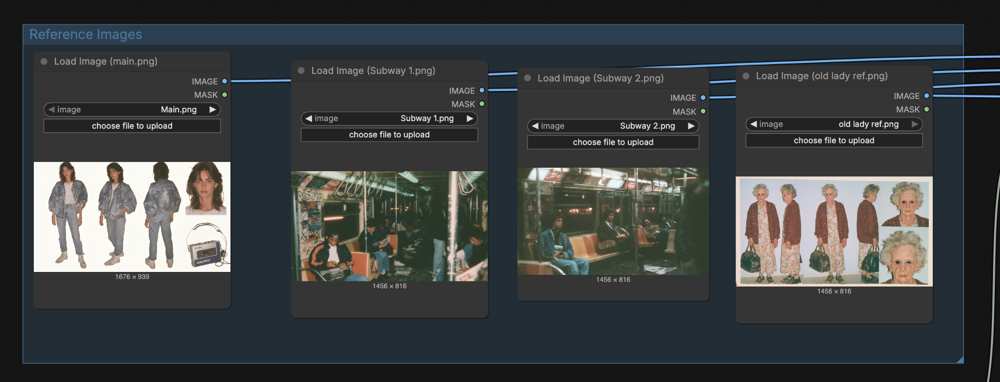
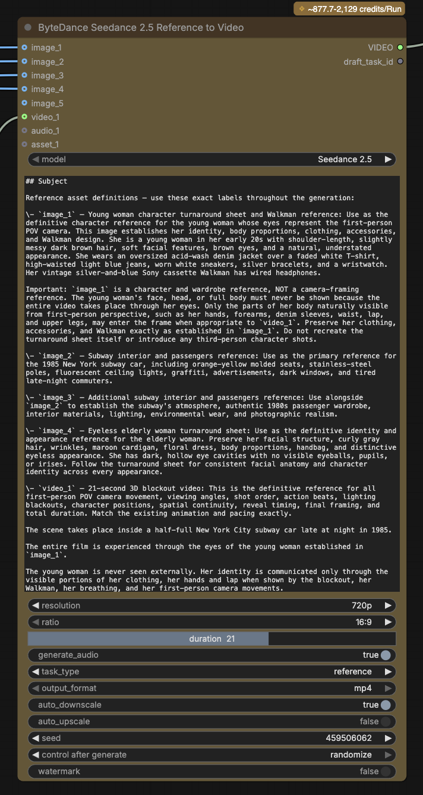

# Haunted Subway

A 21-second first-person horror short in a 1985 New York subway car. Seedance 2.5 renders it from a rough Blender blockout and four reference images.

| | |
| --- | --- |
| **What it makes** | A 21-second, 720p, 16:9 video with sound. The viewer sits on a late-night subway. The lights fail, the car empties, and an eyeless old woman comes closer with each blackout until she is inches from the camera. |
| **How it works** | One Seedance 2.5 reference Node takes a blockout video and four images. The blockout controls the camera, shot order, and timing. The images control who appears and how the world looks. A long, structured prompt assigns each reference one job. |
| **Why it's worth a look** | It shows a previs method you can use on any project: block the shot in 3D first, then let the model render it. The prompt is a template for labeling references so the model uses each one for one thing only. |

## Contents

- [01 · Shared on](#01--shared-on)
- [02 · Files](#02--files)
- [03 · Run on Comfy Cloud](#03--run-on-comfy-cloud)
- [04 · Run on Comfy Desktop or a local ComfyUI](#04--run-on-comfy-desktop-or-a-local-comfyui)
- [05 · Inputs](#05--inputs)
- [06 · The prompt](#06--the-prompt)
- [07 · Make it your own](#07--make-it-your-own)
- [08 · Troubleshooting](#08--troubleshooting)

## 01 · Shared on

| Channel | Link |
| --- | --- |
| X | [@ComfyUI, post 2115089830585704602](https://x.com/ComfyUI/status/2115089830585704602) |
| Discord | _Not yet shared._ |
| LinkedIn | _Not yet shared._ |
| Reddit | _Not yet shared._ |

## 02 · Files

| File | What it is |
| --- | --- |
| [haunted-subway_local.json](haunted-subway_local.json) | The Workflow for Comfy Desktop or a local ComfyUI instance. Its `Load Image` and `Load Video` Nodes point at the files in `media/`. |
| [Open in Comfy Cloud](https://t.co/a2wZTjQGOJ) | The Workflow on Comfy Cloud. Requires a Comfy account. |
| [media/main.png](media/main.png) | `image_1`. The young woman's turnaround sheet. |
| [media/subway-1.png](media/subway-1.png) | `image_2`. The subway car and passengers. |
| [media/subway-2.png](media/subway-2.png) | `image_3`. More of the subway car and passengers. |
| [media/old-lady-ref.png](media/old-lady-ref.png) | `image_4`. The eyeless old woman's turnaround sheet. |
| [media/subway-blockout-21s.mp4](media/subway-blockout-21s.mp4) | `video_1`. The 21-second 3D blockout. |

## 03 · Run on Comfy Cloud

| Step | What to do |
| --- | --- |
| Open | Open the [Haunted Subway Workflow on Comfy Cloud](https://t.co/a2wZTjQGOJ). If the canvas opens empty, sign in first. |
| Run | Click **Run**. The inputs are already loaded. |
| Cost | Seedance 2.5 is a Partner Node, so each run spends Comfy Credits. At these settings, the Node estimates 878 to 2,129 credits per run. |

**Caution:** Before you run, check the credit estimate above the Partner Node. It changes with duration and resolution.

## 04 · Run on Comfy Desktop or a local ComfyUI

This is the same Workflow as the Cloud version, but you supply the input files.

**Note:** Seedance 2.5 is a Partner Node. It runs on ByteDance's servers, so you don't need a GPU. When ComfyUI runs on your machine, the Node still sends the job to ByteDance through Comfy and spends Comfy Credits. To run on your own GPU, replace the Node with an open video model that supports reference inputs and fits in your VRAM.

| Step | What to do |
| --- | --- |
| Requirements | Comfy Desktop, or ComfyUI with frontend 1.60.0, the version this Workflow was saved with. No GPU. A Comfy account with Comfy Credits. |
| Custom Nodes | None. |
| Models | None. |
| Get the files | Download this folder. On GitHub, select **Code > Download ZIP** to get the whole repo, or download each file in `media/`. |
| Copy the inputs | Copy the four images and the blockout video from `media/` into `ComfyUI/input`. You don't need the screenshots. In Comfy Desktop, open the input folder from the app menu. |
| Load | Drag `haunted-subway_local.json` onto the canvas. |
| Sign in | Sign in to your Comfy account in Comfy Desktop. Partner Nodes require it. |
| Run | Click **Run**. The video saves to `ComfyUI/output/video/` with the prefix `Seedance2.5_r2v`. |

## 05 · Inputs

All five inputs connect to one `ByteDance2ReferenceNodeV2` Node. The labels in the prompt match the Node's input slots.

| Slot | File | What the model takes from it | What it must not take |
| --- | --- | --- | --- |
| `image_1` | `main.png` | The POV character's clothes, hands, bracelets, watch, and Walkman | Her face, or the turnaround layout as a shot |
| `image_2` | `subway-1.png` | The 1985 car, seats, poles, lights, graffiti, and passengers | |
| `image_3` | `subway-2.png` | More period detail and passenger wardrobe | |
| `image_4` | `old-lady-ref.png` | The old woman's face, hair, cardigan, dress, handbag, and hollow eyes | |
| `video_1` | `subway-blockout-21s.mp4` | Camera path, head turns, shot order, blackouts, her positions, timing, and length | Its gray placeholder look |

*The Reference Images group. The Nodes in this screenshot show the original file names, such as `Main.png`.*

| Setting | Value |
| --- | --- |
| Model | Seedance 2.5 |
| Resolution | 720p |
| Aspect ratio | 16:9 |
| Duration | 21 s, to match the blockout |
| Generate audio | On |
| Auto downscale | On |
| Seed | Randomized each run |

*The Seedance 2.5 Node with its inputs, the start of the prompt, and its settings.*

## 06 · The prompt

The prompt is in the Node's text box. It is long on purpose. Its structure is the part you can reuse:

| Section | What it does |
| --- | --- |
| Subject | Defines each reference by label and says what it controls. `image_1` is a costume reference, not a camera reference. |
| Action | Lists the beats in order: the empty car, the look around, the laugh, the turn right, each blackout, and the close-up. It says these beats describe the blockout and must not retime it. |
| Spoken language lock | Sets the one line of dialogue, word for word, in American English, in one deep register. |
| Camera | Strict first person. The blockout is the only camera source. |
| Style | Kodak Vision3 500T film, 1985 subway photography, no gore. |
| Constraints and negatives | Repeats the rules as checklists, then lists what must not appear. |

## 07 · Make it your own

| Change | How |
| --- | --- |
| Use your own scene | Block the scene in Blender, Unreal, or any 3D tool. Render a gray pass at the length you want, and swap it into `video_1`. Set **Duration** to match. |
| Use your own characters | Swap the turnaround sheets. Keep the prompt's rule for each one: identity comes from the sheet, and the camera comes from the blockout. |
| Try different video models | Try a different open-weight model or Partner Node. |
| Change the dialogue | Edit the line in the Spoken language lock section and the matching line in Constraints. |

## 08 · Troubleshooting

| Problem | Try this |
| --- | --- |
| A Load Node shows a missing file | The file isn't in `ComfyUI/input`, or its name changed. The names must match exactly: `main.png`, `subway-1.png`, `subway-2.png`, `old-lady-ref.png`, `subway-blockout-21s.mp4`. |
| The Node asks you to sign in | Sign in to your Comfy account in Comfy Desktop, then run the Workflow again. |
| The run fails with a credits error | Add Comfy Credits to your Comfy account. |
| The young woman's face appears on screen | Check that `main.png` is connected to `image_1`, not another slot. The prompt refers to slots by number. |
| The timing drifts from the blockout | Check that **Duration** equals the blockout's length. |
